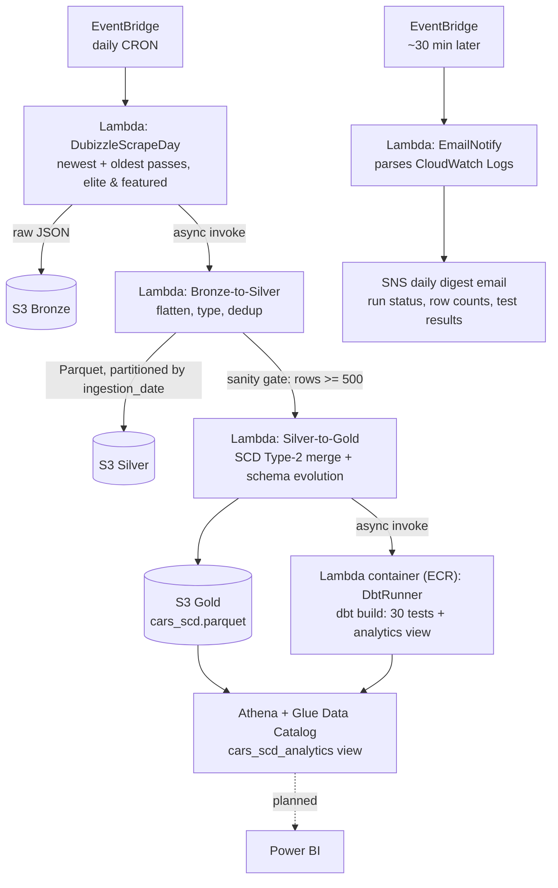
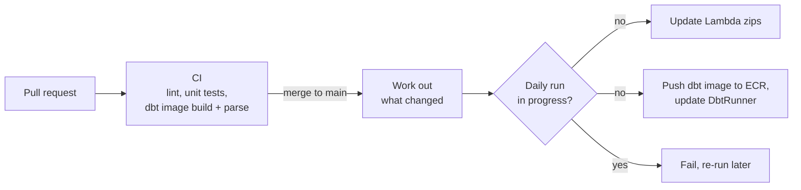

# 🚗 Used Car Market Intelligence Pipeline
### A serverless data lakehouse on AWS for tracking used car listings on Dubizzle Egypt

[](https://github.com/ahmed-emad-dataeng/cars-for-sale-DWH/actions/workflows/deploy.yml)

This project builds an end-to-end data pipeline that scrapes used car listings daily, tracks their full lifecycle using SCD Type-2, and makes them queryable via Athena for market intelligence. It uses **delisting events as a proxy for sales** to answer questions like *which cars sell fastest, and at what price points?*

> **Status: live.** The pipeline has run unattended on AWS every day since **2026-03-07**.

## At a glance

Figures from the Gold snapshot committed in [`Raw Data/2026-07-05/`](Raw%20Data/2026-07-05) (first 4 months of operation):

| Metric | Value |
|---|---|
| Unique listings tracked | **66,773** |
| SCD Type-2 history rows | **132,951** (active / updated / deleted versions) |
| Listings active on any given day | ~13,000 |
| New listings captured per day | ~464 (median; day 1 backfilled ~13.6K existing listings) |
| Listing updates captured as new versions | 56,816 |
| Brands / models | 127 / 1,179 |
| Gold schema | 82 columns, incl. 43 `feature_*` flags |
| Automated data-quality tests per run | 30 (dbt) |

---

## Architecture



Lambdas are chained with direct asynchronous invocations (`InvocationType='Event'`). See *Key Engineering Decisions* for why this design doesn't use Step Functions.

---

## Pipeline Stages

### Bronze — Raw Ingestion
On each daily run the scraper makes two passes over Dubizzle's internal search API: one sorted `desc` (newest listings) and one sorted `asc` (oldest listings). This two-pass approach maximises coverage across the full inventory. Elite and featured listings — which appear in separate response buckets — are captured and merged in. Raw JSON is saved as-is to S3, preserving original fields for reprocessing if the transformation logic changes.

### Silver — Typed & Flattened
Bronze-to-Silver performs all structural transformation:

- **Deduplication**: On ID, newest wins — the two scrape passes can return the same listing.
- **Schema flattening**: `formattedExtraFields` is a variable-length list of `{name_l1, formattedValue_l1}` pairs. These are pivoted into individual columns. Extra Features (air conditioning, sunroof, etc.) become boolean `feature_*` columns — `NaN` means unknown, not absent.
- **Type coercion**: `Price`, `Year`, `Kilometers`, and other numeric fields are coerced from string with `pd.to_numeric(..., errors='coerce')` into `Float64` (nullable). `createdAt` / `updatedAt` Unix timestamps are converted to ISO-8601 strings.
- **Output**: Parquet partitioned by `ingestion_date=YYYY-MM-DD/`, registered as an Athena partition after write.

### Gold — SCD Type-2 History Table
The Gold layer maintains `cars_scd.parquet`, a single cumulative file that tracks the full history of every listing. The SCD merge logic:

| Scenario | Action |
|---|---|
| ID not in Gold | Insert new row: `status=active` |
| ID in Gold, `updatedAt` changed | Close old row (`status=updated`, `scd_valid_to=today`), insert new active row preserving `first_seen_date` |
| ID in Gold, `updatedAt` unchanged | No-op — leave existing row untouched |
| Active ID absent from Silver | Close row (`status=deleted`, `scd_valid_to=today`) |

Schema evolution is handled via `align_schemas()` — new `feature_*` columns appearing in Silver are backfilled as `False` in existing Gold rows; columns disappearing from Silver are filled `None`. SCD metadata columns (`first_seen_date`, `scd_valid_from`, `scd_valid_to`, `status`) are excluded from this alignment.

---

## Key Engineering Decisions

**SCD Type-2 over snapshot overwrite**
A simple daily overwrite would lose all history. SCD Type-2 lets us reconstruct the full timeline of any listing — when it appeared, when its price changed, and when it was delisted — enabling `days_listed` and `days_to_sell` calculations in Athena.

**Parquet over CSV for Athena**
CSV with `OpenCSVSerde` forces all columns to string, making numeric comparisons awkward and failing silently on special-character column names (e.g., `Power (hp)`). Parquet carries schema metadata natively, handles nullable numerics cleanly, and is significantly faster to scan in Athena.

**Sanity check gate before Gold**
If the scraper returns an abnormally low row count (default threshold: 500), the Bronze-to-Silver Lambda does not invoke Silver-to-Gold. A bad scrape day would otherwise look like a mass-delisting event, corrupting the SCD table with thousands of false `status=deleted` entries. The threshold is tunable via `MIN_SILVER_ROWS` env var.

**Silver deduplication before SCD merge**
The SCD loop builds `gold_active_map` once before iterating. If Silver itself contains duplicate IDs (same listing in both newest and oldest passes), the loop would insert two active rows for the same ID within a single run. Deduplicating Silver upstream (newest `updatedAt` wins) eliminates this class of bug cleanly.

**Direct Lambda chaining over Step Functions**
The pipeline is a strict linear chain with no branching, parallelism, or retry-state requirements. Direct async `InvocationType='Event'` invocations keep the architecture simple and avoid the overhead of defining a state machine for a three-step sequence.

**Delisting as sales signal**
Dubizzle does not expose a "sold" status. A listing disappearing from the API — captured as `status=deleted` in Gold — is the best available proxy for a sale. This is the core analytical assumption of the project; a configurable buffer rule to handle single-day scrape gaps vs. confirmed delistings is on the roadmap.

**dbt for data tests and the BI view**
Data-quality checks live in a dbt project (`dubizzle_dbt/`) that runs after every Silver-to-Gold merge, testing the Gold table where it's actually consumed (Athena) rather than in pandas. Severity is split deliberately: SCD-integrity violations (duplicate active rows, overlapping periods) are **errors** — they mean the merge logic broke; seller-input junk (900M-km odometers) are **warnings** — chronic source noise that shouldn't redden the digest. dbt also owns the `cars_scd_analytics` view, so the BI layer's SQL is version-controlled instead of living in the Athena console.

---

## Data Quality (dbt)

The `dubizzle_dbt/` project runs right after every Silver-to-Gold merge, from a container-image Lambda (dbt-core + dbt-athena), so tests run against the table as Athena actually serves it:

- **Source freshness** on `_ingestionDate`.
- **Generic tests** on the source and the `cars_scd_analytics` model.
- **Singular SQL tests** in `tests/`: one active row per listing, no overlapping SCD periods, valid SCD date order, closed rows always have an end date, `days_to_sell` only for delisted rows, no future or ancient dates, kilometres plausible for the model year, price null-rate and minimum active-count thresholds, and more.
- **Severity tiering:** a broken SCD invariant is an **error**, because the merge logic is wrong. Seller-input noise (e.g. 900M-km odometers) is a **warning**, because it's chronic and outside our control and shouldn't turn every digest red.

## Monitoring

`EmailNotify` runs on its own EventBridge schedule ~30 minutes after the scrape. It reads that day's CloudWatch Logs from every pipeline function, including the `DBT PASS/FAIL/SUMMARY` lines, and sends one SNS digest email with run status, row counts at each layer, and data-quality results. One email a day shows whether the pipeline is healthy.

## CI/CD

Every pull request has to pass CI before it can merge, and merging deploys only what changed. GitHub Actions gets short-lived AWS credentials through OIDC, so the repo stores no AWS keys.



- **Unit tests** pin the behaviour that can damage data if it breaks: the SCD merge, same-day re-runs, schema alignment and the sanity gate. They run against the same `pandas` and `pyarrow` versions as the live Lambda layer.
- **The dbt image** is built on every PR, with `dbt parse` and a handler import run inside it.
- **Deploys verify themselves**: each one compares the live code hash or image digest with what was built.

See [`deploy/README.md`](deploy/README.md) for setup, manual deploys, rollback and the drift check.

## Lessons from Running It

- **Relisting is real.** 5,730 listings were closed as `deleted` more than once: they disappeared, then came back. Some are genuine relistings; others are scrape gaps. This is the evidence behind the *scrape-gap buffer* item on the roadmap.
- **A bad scrape must never look like a market crash.** Without the sanity gate, one partial scrape would close thousands of active listings as "sold" and corrupt every days-to-sell metric.
- **Schema drift is constant.** Sellers and the platform add new feature flags over time, so the Gold merge aligns schemas automatically instead of failing.

---

## Data Model

The Gold table (`cars_scd.parquet`) schema:

| Column | Type | Description |
|---|---|---|
| `id` | int64 | Dubizzle internal listing ID |
| `externalID` | string | Public-facing ID (used in URL) |
| `title` | string | Listing title |
| `Price` | Float64 | Listed price (EGP) |
| `Year` | Float64 | Model year |
| `Kilometers` | Float64 | Odometer reading |
| `Brand` | string | Car manufacturer |
| `Model` | string | Car model |
| `Body Type` | string | e.g. Sedan, SUV |
| `Transmission Type` | string | Automatic / Manual |
| `feature_*` | boolean | One column per extra feature; `NaN` = unknown |
| `updatedAt` | string | ISO-8601 timestamp of last listing update |
| `first_seen_date` | string | Date listing first appeared in the pipeline |
| `scd_valid_from` | string | Date this row version became active |
| `scd_valid_to` | string | Date this row version was closed (`null` if active) |
| `status` | string | `active` / `updated` / `deleted` |

This is a high-level summary — see [`Raw Data/README.md`](Raw%20Data/README.md) for the full 82-column reference, including all `feature_*` flags and less commonly used fields.

`last_seen_date` and `days_listed` are computed on-the-fly in Athena rather than stored — keeping the Gold table append-only and avoiding recomputation on every write.

---

## Analytical Use Cases

Once the SCD table is built, the `cars_scd_analytics` Athena view computes BI-ready columns on top of it — `days_listed`, `days_to_sell`, `age_in_years`, `price_per_km`, `feature_count`, `has_premium_features`, `has_safety_suite`, `price_segment`, `mileage_category`, and `is_current_active` — to answer questions like:

- **Fast sellers**: Active listings with `days_listed < N` before `status=deleted`
- **Slow / stale inventory**: Active listings with `first_seen_date` more than X days ago
- **Price sensitivity**: Do price-updated listings (`status=updated` with `Price` change) sell faster afterward?
- **Make/model velocity**: Which makes and models turn over fastest in the Egyptian market?
- **Seasonality**: Are there weekly or monthly patterns in listing volume or delisting rate?

See [`Raw Data/README.md`](Raw%20Data/README.md#analytics-view-export-athena-viewcsv) for the full column reference of this view's export.

---

## Tech Stack

| Layer | Technology |
|---|---|
| Compute | AWS Lambda (Python 3.14) |
| Storage | AWS S3 (Bronze / Silver / Gold buckets) |
| Query | AWS Athena |
| Scheduling | Amazon EventBridge |
| Data format | Parquet (snappy compression) via `pyarrow` |
| Transformation | `pandas`, `boto3` |
| Data quality & BI view | `dbt-core` + `dbt-athena` (tests + `cars_scd_analytics` model), packaged as a Lambda container image (ECR) |
| Monitoring | Amazon CloudWatch Logs (parsed by `EmailNotify`), Amazon SNS (digest email delivery) |
| CI/CD | GitHub Actions with AWS OIDC, `pytest`, `ruff`, `black` |
| Reporting | Athena view ready for BI; Power BI dashboard planned |

---

## Repository Structure

```
├── .github/workflows/                 # ci.yml (every PR) and deploy.yml (merge to main)
├── deploy/                            # Function list, one-time AWS setup, deployment guide
├── scripts/deploy_lambdas.py          # Drift check and deploy logic used by the workflows
├── tests/                             # Unit tests for the Lambda code and deploy script
├── Lambda Scripts/
│   ├── DubizzleScrapeDay.py           # Production scraper: hits Dubizzle API, saves raw JSON to Bronze
│   ├── dubizzleLambda.py              # Standalone reference/template version of the scraper (no S3 config, hardcoded placeholders)
│   ├── Bronze-to-Silver.py            # Transforms & types raw JSON → partitioned Parquet
│   ├── Silver-to-Gold.py              # SCD Type-2 merge into Gold history table; chains to DbtRunner
│   ├── dbt-runner/                    # DbtRunner Lambda: Dockerfile, handler.py, baked profiles.yml
│   ├── EmailNotify.py                 # Daily digest email via SNS, parses CloudWatch logs from the other functions
│   └── Test_gold_layer.py             # Pandas-level test suite for ad-hoc parquet checks (SQL-level tests live in dubizzle_dbt/)
├── dubizzle_dbt/                      # dbt project: data tests + cars_scd_analytics model (see its README)
│   ├── models/staging/sources.yml     # cars_scd source definition + generic tests + freshness
│   ├── models/marts/                  # cars_scd_analytics.sql + model tests
│   └── tests/                         # Singular SQL tests (SCD integrity, business rules)
├── Raw Data/                          # Sample data, tracked in git — only the latest snapshot plus the original legacy one are kept at a time to manage repo size
│   ├── README.md                      # Full column reference + snapshot history
│   ├── gold_layer_2026-04-05.parquet  # Legacy first snapshot (root-level, old naming convention)
│   ├── gold 2026-04-05.csv
│   ├── gold 2026-04-05 sample.csv
│   └── 2026-07-05/                    # Latest snapshot
│       ├── gold-layer.parquet / .xlsx / -sample.csv
│       └── Athena View.csv            # Export of the cars_scd_analytics Athena view
└── README.md
```

Configuration (credentials, S3 paths, API headers/payloads) is managed via a `config.json` file stored in S3, keeping secrets out of the codebase. Lambda environment variables are used for inter-function references and tunable thresholds.

---

## Setup Notes

The pipeline runs entirely on AWS. To replicate it you will need:

- Three S3 buckets (Bronze, Silver, Gold) or a single bucket with prefix-based separation
- Five Lambda functions with the appropriate IAM roles (S3 read/write, Lambda invoke, plus CloudWatch/SNS for `EmailNotify`, plus Athena/Glue for `DbtRunner`)
- A `config.json` uploaded to S3 with the API endpoint, request headers, and payload templates
- Environment variables set on each Lambda (bucket names, function names, `MIN_SILVER_ROWS`)
- An EventBridge rule triggering `DubizzleScrapeDay` on your desired schedule
- A second EventBridge rule triggering `EmailNotify` ~30 min after the scrape CRON, an SNS topic (subscribed to your email), and the following env vars on `EmailNotify`: `SCRAPE_LOG_GROUP`, `B2S_LOG_GROUP`, `S2G_LOG_GROUP`, `DBT_LOG_GROUP` (optional), `SNS_TOPIC_ARN`, `PIPELINE_TZ_OFFSET`. Required IAM permissions: `logs:FilterLogEvents`, `logs:DescribeLogStreams`, `sns:Publish`.
- The `DbtRunner` Lambda deployed from a container image (see `Lambda Scripts/dbt-runner/Dockerfile`; build from the repo root, push to ECR). Env vars: `DBT_ATHENA_REGION`, `DBT_ATHENA_SCHEMA`, `DBT_ATHENA_S3_STAGING`. IAM: Athena query execution, Glue catalog read/write (view creation), and S3 read/write on the gold bucket + staging prefix. Set `DBT_RUNNER_FUNCTION` on `Silver-to-Gold` to enable the chain (skipped gracefully if unset). Recommended: memory ≥ 1024 MB, timeout ≥ 5 min.

---

## Roadmap

- [x] Athena views for fast-seller and slow/unsold analysis
- [x] `days_listed` and `days_to_sell` analytical columns via Athena views
- [x] Automated data-quality tests (dbt) after each daily run, results in the daily digest
- [x] CI/CD with GitHub Actions: tests on every PR, automatic deploys on merge
- [ ] Price history table (append-only change log, separate from SCD)
- [ ] Scrape-gap buffer rule: require N consecutive missing days before marking a listing as `deleted`
- [ ] More granular SCD change detection (column-level diff beyond `updatedAt`)
- [ ] Power BI dashboard (DirectQuery over Athena): listing velocity, price distribution, make/model heatmaps